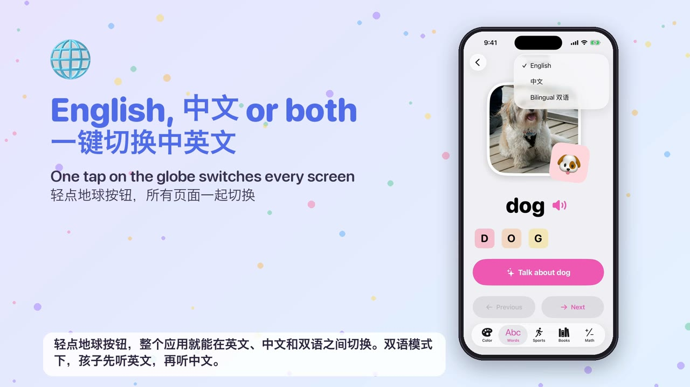
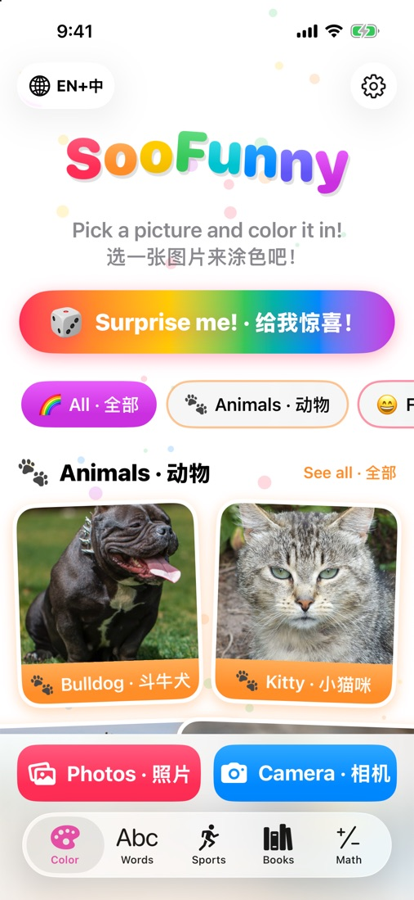
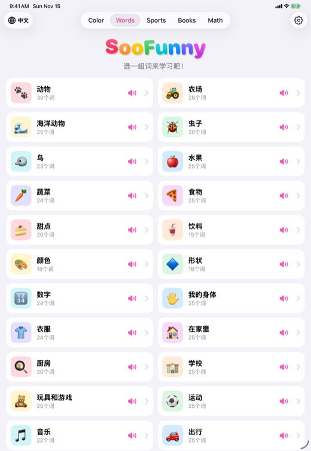
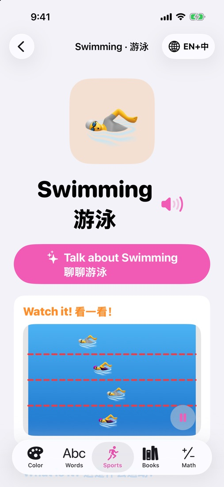
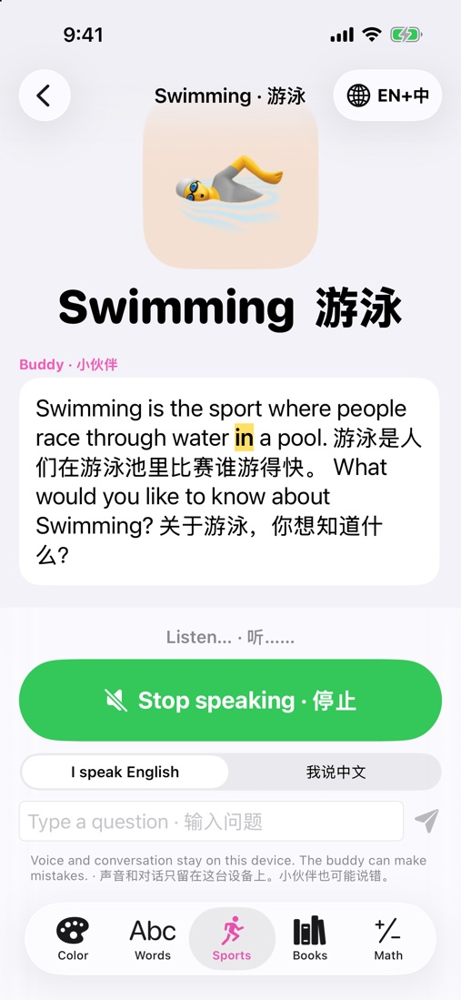
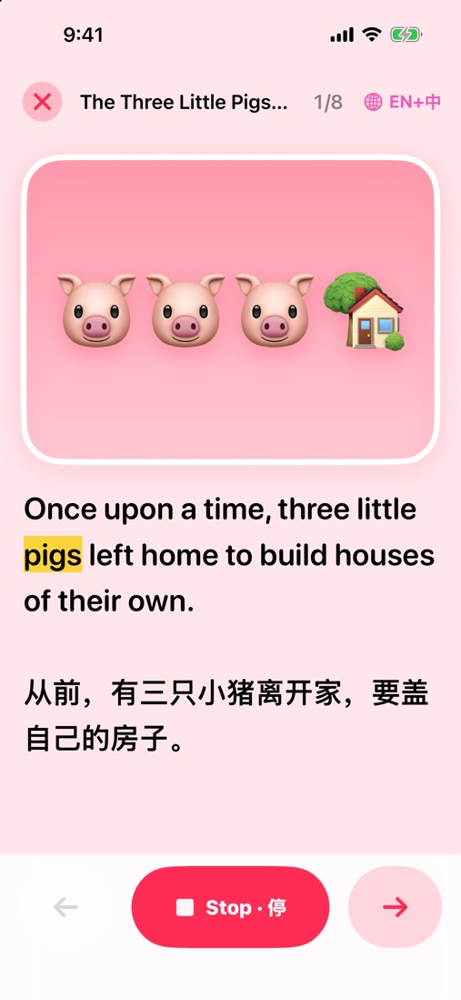
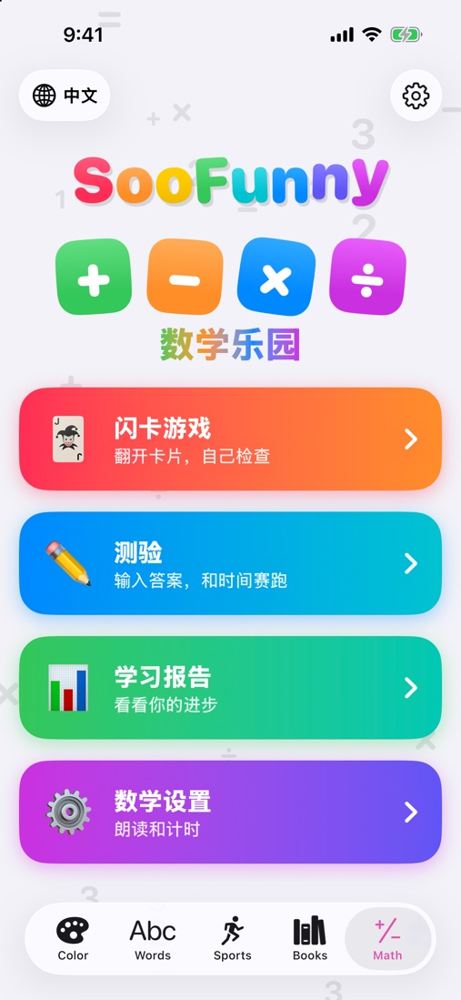
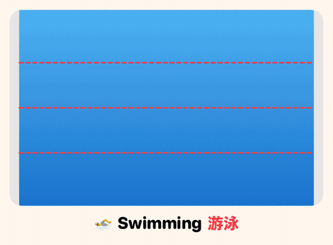
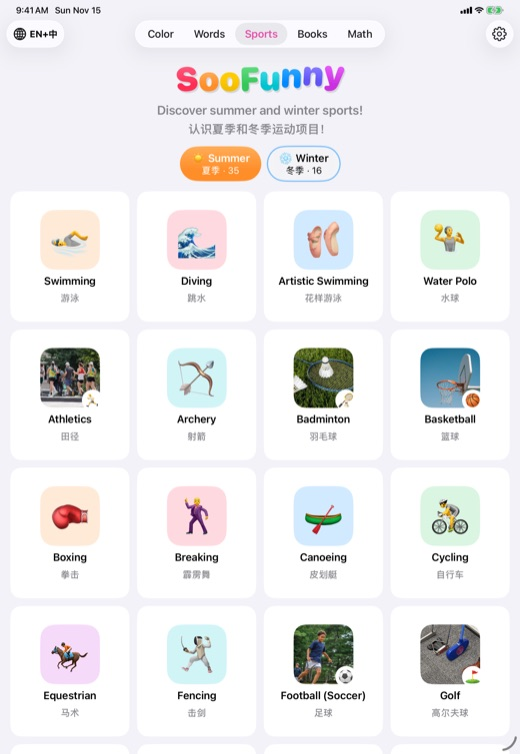

# SooFunny 🖍️

**Color, words, books, sports and math for kids, on iPhone and iPad, completely offline.**

SooFunny turns any picture into a coloring page, lets kids explore 754 words with a talking
buddy that answers their questions out loud, reads picture books aloud (including the family's
own books, scanned in English, Chinese or both), makes math practice feel like a game, and
introduces 51 summer and winter sports. Every tab works in **English, 中文 or Bilingual 双语**.
Everything runs on the device: no Wi‑Fi, no accounts, no ads, and nothing a child says, draws or
photographs ever leaves the device.

<p align="center"></p>

<p align="center">
  <a href="marketing/SooFunny-bilingual-demo.mp4"></a><br>
  <b>▶️ <a href="marketing/SooFunny-bilingual-demo.mp4">Watch the bilingual demo for parents</a></b> (3 minutes, English then Chinese, with captions)<br>
  Photos to coloring pages, the talking buddy in English and Chinese, books read aloud (even your own), sports, math,<br>
  and the language switch · 照片变涂色画、会说话的小伙伴、绘本朗读、运动和数学，中英双语
</p>

<p align="center">
  🎞️ <a href="marketing/SooFunny-demo.mp4">2-minute English demo</a> ·
  🎬 <a href="marketing/SooFunny-presentation.mp4">2-minute presentation</a> (the slides, narrated) ·
  🏅 <a href="marketing/SooFunny-sports.mp4">Sports animations</a> (36 s, 12 sports) ·
  📑 <a href="marketing/SooFunny-slides.pdf">Introduction slides</a> (PDF)
</p>

<p align="center">
  
  &nbsp;
  
  &nbsp;
  
  &nbsp;
  
</p>

<p align="center">
  
  &nbsp;
  
</p>

<p align="center"></p>

| | |
|---|---|
| **Version** | 0.4 (build 9) in App Review; 0.3 (build 5) is [on the App Store](https://apps.apple.com/us/app/soofunny/id6827777441) |
| **Platforms** | iPhone and iPad, iOS 17 or later, all orientations |
| **Developers** | Chengjiang Long and Yao Xu |
| **Contact** | [chengjiang.long@gmail.com](mailto:chengjiang.long@gmail.com) |
| **Copyright** | © 2026 Soo X Intelligence LLC. All rights reserved. |

---

## Contents

- [Features](#features)
- [How it works](#how-it-works)
- [Free, with optional tips](#free-with-optional-tips)
- [Privacy and child safety](#privacy-and-child-safety)
- [Building and running](#building-and-running)
- [Android (in progress)](#android-in-progress)
- [Tests](#tests)
- [Project layout](#project-layout)
- [Changing content](#changing-content)
- [Releasing on the App Store](#releasing-on-the-app-store)
- [Performance](#performance)
- [Known limitations](#known-limitations)
- [Credits and licenses](#credits-and-licenses)

---

## Features

### 🌐 English, 中文 or Bilingual

- One setting for the whole app, switched with the **globe** button at the top of every tab (and
  on word, sport, quiz, buddy and book pages) or in **Settings → Language 语言**.
- **English** or **中文** shows and reads everything in that language. **Bilingual 双语** shows the
  English first with the Chinese after it, and reads them aloud in that order: English in the
  natural voice, Chinese in the natural Chinese voice.
- Covers the picture names on Color, all 754 words and 32 groups, every built-in book (each one
  is in both languages), the sports, math questions and cheers (numbers read as Chinese words),
  and the talking buddy, which answers and listens in the chosen language.
- The tabs are **Color, Words, Sports, Books and Math**.

### 🎨 Color

- **A playful gallery**: a bouncing rainbow title, a **Surprise me!** button that opens a random
  picture, and sticker-style cards in five groups: **Animals**, **Faces**, **People**,
  **Outdoors** and **Drawings**. That's 21 free (CC0) photos plus 4 drawings made in code
  (House, Fish, Flower, Rocket).
- **Your own pictures**: **Photos** and **Camera** buttons at the bottom of the page.
- **Automatic coloring pages**: any picture becomes clean black outlines around kid-sized blocks.
  Choose **Big**, **Medium** or **Small** blocks.
- **Easy coloring**: tap a block, or drag a finger across several. Taps on a line snap to the
  nearest block.
- **Tools**: Undo, **Magic** (random colors everywhere), **Real** (each block in its photo
  color), **Peek** (see the original underneath), Clear, Eraser and a custom color picker. 18
  crayon colors.
- **Share or save** the finished picture with the system Share button.

### 📚 Words

- **32 word groups, 754 words**, each with its Chinese, written for SooFunny: Animals, Farm, Sea Creatures, Bugs,
  Birds, Fruit, Vegetables, Food, Sweets, Drinks, Colors, Shapes, Numbers, My Body, Clothes,
  At Home, Kitchen, School, Toys and Games, Sports, Music, Going Places, Weather, Seasons and
  Time, Nature, Space, Jobs, People, Feelings, Action Words, Opposites and Around Town.
- Every word has an emoji picture (or a colorful letter tile) and a **speaker** button.
  516 of the 754 words also show a **real photo**, with the emoji stuck on its corner like a
  sticker. On the talking buddy screen, most of them show one or two more photos beside it. Words that can't be photographed well (numbers, feelings, time words) keep just the
  emoji.
- A word page shows the word big (English, Chinese, or English above Chinese), reads it aloud, lets
  kids tap each **letter** or Chinese **character** to hear it, and has Previous / Next.
- Tap a group to see its words; **Back** returns to the groups.

### ✨ Talking buddy

Every word and every sport has a sparkle **Talk about …** button that opens a spoken conversation,
inspired by the [Wonder Words Agent demo](https://www.youtube.com/shorts/ZAaAPILTohk):

1. The buddy explains the word in a sentence or two, then asks
   *"What would you like to know about lion?"*
2. It listens. The child asks out loud ("What does a lion eat?") or types a question.
3. It answers in a few short, kind sentences, read aloud with each word highlighted, then
   listens again.

The big button follows the turn: **Talk**, **Done** (while listening), **Cancel** (while
thinking) and **Stop speaking**. The answers come from **Qwen 2.5 1.5B**, running on the
device. It talks in English, Chinese or both, following the language switch; in Bilingual every
sentence comes in English and then Chinese, and **I speak English / 我说中文** picks the language it
listens for. On a sport it's given that sport's introduction, so its answers match what the child
just heard. Chinese listening needs no Chinese keyboard on iOS 26 and later: the app downloads
Apple's Mandarin speech model the first time, then listens fully on the device.

### 🏅 Sports

<p align="center">
  
  &nbsp;
  
</p>

- **51 sports**: the 35 summer and 16 winter sports on the 2024 and 2026 Games programmes,
  switched with the **Summer 夏季** and **Winter 冬季** buttons. On-screen text and the store
  listing don't name the Games, since App Review rejects unlicensed use of those trademarks;
  `SportsTests` checks for them.
- Each sport has an emoji (and a real photo for 12 of them, shared with the Words tab), its
  English and Chinese names, and a short introduction written for children in **both languages**,
  shown in English, Chinese or both.
- **Watch it! 看一看！** plays a looping animation of each sport: swimmers racing down their
  lanes, a diver flipping into the pool, an arrow flying into the target, a bobsled racing down the
  ice chute, and so on. Tap pause to stop it; it starts paused when Reduce Motion is on.
- **Reads itself aloud**: opening a sport (or Previous / Next) says its name and then reads what
  it is, with each word lighting up; in Bilingual, English and then Chinese. The speaker button
  hears it all again.
- **Talk about …** opens the talking buddy for that sport, so children can ask anything about it.
- The sports are in `SooFunny/Sports/OlympicSports.swift` and their animations in `SportDemos.swift`
  (a scene from `DemoScenes.swift` plus emoji and balls moving along keyframed paths, drawn by
  `SportDemo.swift`). The whole tab is free.

### 📖 Books

- **Story books**: 10 books, SooFunny's own short retellings of public-domain tales and rhymes, including The Three Little Pigs,
  Goldilocks, The Gingerbread Man, nursery rhymes, and two first written in Chinese (唐诗五首 Tang
  Poems and 龟兔赛跑 The Tortoise and the Hare). **Every book is in both languages**, page by page,
  and follows the language switch (the reader has its own globe button).
- **Read aloud**: tap **Read to me · 读给我听** and each page is read with the current word lit up,
  turning pages by itself; in Bilingual, the English and then the Chinese. Swipe or tap the arrows
  to turn pages by hand.
- **My books**: **Scan a book** with the camera (one or many pages) or pick pages **From
  Photos**. The text is read from each page on the device, in English, Chinese or a mix of both.
  Before saving, grown-ups can fix the words, remove pages and **Change page order** by dragging.
- **Mixed languages**: English parts are read in the natural voice and Chinese parts in Apple's
  Chinese voice, one after another. Pinyin printed above the characters is skipped.
- **Audiobooks**: **Make audiobook** records the whole book into an `.m4a` file to listen to
  anytime or share.

### ➕ Math

Inspired by [Best Math App for Kids](https://www.youtube.com/watch?v=hVBYZOaC5iw):

- **Flashcard Game**: choose operations (+ − × ÷), the numbers 0–12 to focus on, 10/20/30
  questions, and whether to mark answers. Problems are stacked the school way; tap to reveal,
  then **Got it!** or **Not yet**.
- **Quiz**: "5 − 1 = ?" with a big number pad, a ✓ or ✗ (with the right answer), a timer and
  read-aloud questions.
- **Results**: stars, confetti for a perfect round, and **Practice missed ones**.
- **Progress Reports**: rounds, questions, a day streak, accuracy for each operation, and the
  trickiest facts to practice again.
- **Rules**: every question includes a chosen focus number, subtraction never goes below zero,
  and division always comes out even (never ÷ 0).

### 🗣️ Natural voice

Words, letters, books, math, sports and the talking buddy are read by **Kokoro-82M**, a neural voice
("Heart", a warm American female voice) that runs on the device. Chinese is read by
**Kokoro-82M v1.1-zh**, its Chinese model, in a choice of five voices (Settings → Chinese voice ·
中文声音; Voice 1 is the default). Apple's built-in English voices are still available in
Settings, minus novelty voices like "Boing". If a natural voice can't load, the app uses an
Apple voice automatically.

### ⚙️ Settings

- **Language 语言**: English, 中文 or Bilingual 双语 for every tab.
- **Support SooFunny**: **Leave a tip**. The App Store's purchase sheet asks for Face ID or the
  password, so there's no extra grown-up check.
- **Reading voice**: the voice, its speed (default about 1.05×) and a **Try the voice** button.
- **Chinese voice · 中文声音**: five natural Chinese voices, with **Try the voice · 试听**.
- **Research Lab** (for grown-ups): device info and on-device benchmarks of the coloring
  pipeline, Apple's Vision subject model and Apple's on-device language model (Apple
  Intelligence, iOS 26+), plus a prompt playground. Results stay on the device and export as
  JSON/CSV.
- **Photo credits**, **Reset defaults**, and **About** (version, developers, contact email, copyright).

### 📱 iPhone and iPad

On iPhone, the tabs sit at the bottom and the crayons scroll in one row. On iPad, the tabs sit at
the top, the crayons wrap into a grid, and in landscape the coloring tools move to a sidebar so
the picture stays big.

---

## How it works

### Coloring pages (`SooFunny/Engine/`)

**Drawings** (mostly black lines on white) keep their own lines: each enclosed area becomes a
block.

**Photos** go through a sketch pipeline:

1. **Flatten.** Repeated Kuwahara filtering in CIE Lab color removes texture and shading but
   keeps real edges sharp (`LabImage.swift`).
2. **Find the subject.** Apple's on-device Vision model separates people, pets and objects from
   the background (`SubjectMask.swift`). The subject gets more detail and the background stays
   simple, and no block mixes the two. Photos without a clear subject skip this step.
3. **Group colors.** k-means in Lab color (seeded, so results repeat), separately for subject and
   background, then a majority filter.
4. **Merge.** Neighboring blocks that look alike (small ΔE) join, so a sky stays one block. Tiny
   pieces and slivers merge into the neighbor they share the longest border with, until the
   count fits the chosen block size.
5. **Smooth.** Borders are rounded off, then redrawn at 1024 px with Gaussian-weighted contour
   smoothing, so lines look drawn rather than pixelated.
6. **Outline.** A distance transform draws an even, anti-aliased line about 3 px wide along every
   border.

### Talking buddy (`SooFunny/Assistant/`)

- **Thinking:** Qwen 2.5 1.5B Instruct (4-bit, Q4_K_M), strong in both English and Chinese, is
  bundled with the app and runs with
  [llama.cpp](https://github.com/ggml-org/llama.cpp), built from source as an XCFramework.
- **Prompting:** answers are kept short and child-safe, with the last eight turns of the
  conversation as context. The app adds the "What would you like to know about …?" question
  itself, because a small model doesn't ask it reliably, and trims replies to a few sentences.
- **Listening:** Apple's speech recognition, required to run on the device. A turn ends after a
  1.4 s pause, after 8 s of silence, or after 20 s. Chinese uses Apple's newer `SpeechAnalyzer`
  (iOS 26 and later): the first time a Chinese or Bilingual conversation opens, the app asks iOS
  to download Apple's Mandarin dictation model, so families don't need to add a Chinese keyboard.
  Older iOS versions use the Chinese keyboard's dictation, if it's turned on.
- **Speaking:** answers stream sentence by sentence into the voice, so speech starts before the
  whole answer is written.

### Books (`SooFunny/Books/`)

- **Scanning:** VisionKit's document camera finds and flattens each page; Vision's text
  recognizer reads it on the device (English, Simplified and Traditional Chinese). Lines are
  joined back into sentences, hyphens are rejoined, and page numbers are dropped.
- **Languages:** text is split into runs by script: Han characters are Chinese, other letters
  English. Pinyin (words with tone marks such as ā or ǎ) is removed before reading.
- **Reading:** each run goes to the voice for its language, and runs play one after another.
- **Audiobooks:** `AudiobookMaker` renders every page to audio, with short pauses between
  phrases and longer ones between sentences, and writes an AAC `.m4a`. Phrases that can't be
  spoken are skipped instead of failing the whole book.
- **Storage:** scanned books (page images, text and audiobook) are kept in the app's own
  Application Support folder.

### Natural voice (`SooFunny/Voice/`)

- **The voice:** [Kokoro-82M](https://huggingface.co/hexgrad/Kokoro-82M) (8-bit, 92 MB) with the
  "Heart" voice, run with [ONNX Runtime](https://github.com/microsoft/onnxruntime-swift-package-manager)
  on the CPU.
- **Pronunciation:** text becomes phonemes with a Swift port of the dictionary rules of
  [misaki](https://github.com/hexgrad/misaki), Kokoro's own phonemizer. It uses a
  183,561-word US dictionary, rules for small words ("a", "the", "to"…) and for -s, -ed and -ing
  endings, and spells out numbers. Unknown words are spelled letter by letter. The GPL
  espeak-ng phonemizer is deliberately not used.
- **Chinese:** [Kokoro-82M v1.1-zh](https://huggingface.co/hexgrad/Kokoro-82M-v1.1-zh) (16-bit, 163 MB; the 8-bit file runs three times slower with ONNX Runtime 1.24)
  with voices zf_001, zf_017, zf_032, zf_049 and zf_094. Chinese text becomes Kokoro's zhuyin-style
  phonemes with `ChineseG2P`, a Swift port of misaki's Chinese front end (from PaddleSpeech): jieba's
  dictionary segmentation and part-of-speech HMM, pypinyin's readings (36,000 phrases that read
  differently from their characters), tone sandhi (一, 不, third tones, neutral tones) and 儿化.
  `ChineseG2PTests` checks it matches misaki on all 1,133 Chinese strings in the app. English words
  inside Chinese use the English pronunciations.
- **No dead air:** the silence Kokoro adds around each clip is trimmed, and short natural pauses
  are added instead (0.22 s after a sentence, 0.12 s after a phrase). Long sentences are split
  at commas so speech starts after the first phrase.
- **Instant taps:** recent clips are remembered (up to 400), and likely-next speech is prepared
  in the background: group names, the words in an open group, the next and previous word, its
  letters, every question in a math round, and common cheers. Anything a child taps goes first.
- **Highlighting:** Kokoro doesn't report word timings, so the buddy's word highlighting is
  estimated from each word's length.

---

## Free, with optional tips

**Every feature is free for everyone**, with no locks, limits, ads or accounts, from version 0.3.
Grown-ups who'd like to help keep SooFunny maintained and updated can leave a tip in
**Settings → Support SooFunny**.

| Tip | Price (US) | Product ID |
|---|---|---|
| ☕️ Small | $1.99 | `com.chengjianglong.soofunny.tip.small` |
| 🍰 Medium | $4.99 | `com.chengjianglong.soofunny.tip.medium` |
| 🎁 Large | $9.99 | `com.chengjianglong.soofunny.tip.large` |

- **How:** tips are consumable In-App Purchases (StoreKit 2, `SooFunny/Store/TipJar.swift`) that
  unlock nothing. Apple requires In-App Purchase for tips to a developer that isn't a registered
  nonprofit, so there's no outside donation link in the app.
- **Offline:** the tip screen needs the App Store; offline it says so. Everything else works
  offline as before.
- **Former subscribers:** versions 0.1 and 0.2 sold a yearly subscription
  (`com.chengjianglong.soofunny.premium.yearly`). Anyone whose subscription is still set to renew
  sees a note in Settings with a **Manage subscription** button to cancel it.
- **Testing purchases:** `SooFunny/Store/SooFunny.storekit` holds the three tips and the old
  subscription, so both can be tried in Xcode; the scheme uses it when you press **Run**.

---

## Privacy and child safety

- **No data collected.** No analytics, ads, tracking, accounts or servers. The privacy manifest
  (`SooFunny/PrivacyInfo.xcprivacy`) declares no tracking and no collected data.
- **Photos** are turned into coloring pages on the device and are never uploaded.
- **Scanned books** are read and stored on the device only; their pages and audiobooks leave it
  only if a grown-up shares them.
- **Voice** is recognized on the device only and never recorded or saved. If a device can't
  recognize speech on the device, the buddy doesn't listen; children can type instead.
- **The buddy and the voice** run entirely on the device. Conversations are forgotten when you
  leave the screen.
- **Progress and settings** are stored only on the device.
- **Grown-up check:** the contact email and the Research Lab sit behind a grown-up check;
  tips rely on the App Store's own Face ID or password check. The photo credits are shown as text, not links.
- **Permissions:** the camera, microphone, speech recognition and saving to Photos are each
  requested only when first used.

Full policy: [PRIVACY.md](PRIVACY.md).

---

## Building and running

### Requirements

- A Mac with **Xcode 26 or later** (developed with Xcode 27.1), which includes the iOS SDK.
- **[XcodeGen](https://github.com/yonaskolb/XcodeGen)** and **CMake**:

```bash
brew install xcodegen cmake
```

- **Python 3**. `scripts/make_icon.py` also needs Pillow (`pip install pillow`).
- About **2 GB** of free disk space for the models and builds.

### 1. Get the large pieces (not stored in git)

```bash
./scripts/build_llama.sh
```

This builds llama.cpp (tag `b11577`) as an XCFramework for iOS devices and the Simulator, into
`Vendor/`. It takes a few minutes.

```bash
./scripts/fetch_model.sh
```

This downloads into `Models/`, checking each file's SHA-256:

- Qwen 2.5 1.5B Instruct `qwen2.5-1.5b-instruct-q4_k_m.gguf` (1.1 GB)
- Kokoro-82M `kokoro-82m-q8.onnx` (92 MB)
- Kokoro-82M v1.1-zh `kokoro-v1.1-zh-fp16.onnx` (163 MB)

All three models are bundled into the app (about 1.4 GB in total), so it works offline from the
first launch.

### 2. Generate the Xcode project and open it

```bash
xcodegen generate
```

```bash
open SooFunny.xcodeproj
```

The project is generated from `project.yml`; run `xcodegen generate` again after adding or
removing files. Swift packages (ONNX Runtime 1.24.2) resolve automatically. If command-line
builds fail to resolve them, add `-scmProvider system` to `xcodebuild`.

### 3. Run

- **Simulator:** pick an iPhone or iPad simulator and press **Run**.
- **Your iPhone or iPad:**
  1. Connect it, turn on Developer Mode, and set your Team under *Signing & Capabilities*.
  2. Press **Run**.
  3. The first time, iOS needs **internet once** to verify the developer. If the app won't open,
     go to Settings → General → VPN & Device Management → your developer → **Verify App**.

  With a free Apple ID, device installs expire after 7 days; with the paid Developer Program they
  last a year.

  If a build fails with **"No Accounts"** or **"No profiles for 'com.chengjianglong.soofunny'"**,
  Xcode has lost its sign-in or the development profile has expired: sign in again under
  *Xcode → Settings → Accounts* and build again; Xcode makes a new profile automatically.

From the command line:

```bash
xcodebuild build -project SooFunny.xcodeproj -scheme SooFunny -configuration Debug -destination 'id=<device UDID>' -derivedDataPath build-device -scmProvider system DEVELOPMENT_TEAM=<Team ID> -allowProvisioningUpdates
```

```bash
xcrun devicectl device install app --device <device UDID> build-device/Build/Products/Debug-iphoneos/SooFunny.app
```

---

## Android (in progress)

An Android version in Kotlin and Jetpack Compose lives in [`android/`](android/README.md). Version
0.4 has everything the iOS app has except tips: the five tabs (Color, Words, Sports, Books, Math)
with the English / 中文 / Bilingual 双语 switch, the natural Kokoro voices, the talking buddy
(Qwen 2.5 with llama.cpp, its model downloaded on first use), My books with audiobooks, and the
sports animations. It reads the iOS app's word list, photos, sports and books, so content is
edited once for both. Google Play publishing is the next phase (see
[android/README.md](android/README.md#plan-for-later-versions)).

Requirements: JDK 17 or later, the Android SDK (platform 37), the NDK and CMake, and the voice
models from `scripts/fetch_model.sh`. Then:

```bash
cd android && ./gradlew :app:installDebug -PwithModels=true
```

That builds the app with the voices and installs it on the running emulator or phone
(`android/tools/install_bundle.sh` installs the App Bundle the way Google Play would). `./gradlew :app:testDebugUnitTest`
runs its unit tests. After changing `OlympicSports.swift`, `StoryBooks.swift` or
`StoryTranslations.swift`, run `python3 android/tools/export_ios_data.py` so Android gets the change.

---

## Tests

```bash
xcodebuild test -project SooFunny.xcodeproj -scheme SooFunny -destination 'platform=iOS Simulator,name=<simulator>' -scmProvider system
```

81 unit tests in `SooFunnyTests/`:

| File | What it checks |
|---|---|
| `ImageSegmenterTests` | Blocks and outlines for photos and drawings, gradients, subjects, block limits, rendering |
| `WordDictionaryTests` | Word list format and contents, Research Lab statistics and export, bundled gallery and word photos and their credits |
| `WordAssistantTests` | Prompts, sentence streaming and the buddy's turn flow (with fakes), plus real model runs in English, Chinese and Bilingual |
| `NaturalVoiceTests` | Pronunciations, Swift audio vs. the reference pipeline, speed, phrases, silence trimming, voice choices |
| `BooksTests` | Story library, text recognition in English and Chinese, line joining, mixed-language splitting and pinyin, saving, reordering, and audiobooks |
| `MathTests` | Question rules, flashcard and quiz sessions, scoring, progress and streaks |
| `SportsTests` | Every sport has unique English and Chinese names, introductions in each language, a bundled photo where it reuses one, a working animation, and no trademarked Games names. With `TEST_RUNNER_SPORT_DEMO_SHEETS=<folder>`, it also draws frames of every animation into that folder for checking by eye |
| `TipJarTests` | The three tips and their prices, a tip unlocks nothing, and former subscribers are shown how to cancel |

Tests that need a bundled model skip when it's missing. The 3 model tests take about a minute, so
add `-skip-testing:SooFunnyTests/LlamaEngineTests` for a quick run. The StoreKit purchase tests
skip where the Simulator's local App Store isn't reachable (seen on the iOS 26.4 iPad
simulator); they pass on the iPhone simulator and from Xcode.

---

## Project layout

```
SooFunny/
  App/SooFunnyApp.swift            App entry point and the Color / Words / Books / Math tabs
  Engine/                          Coloring pages
    PixelImage.swift                 RGBA bitmaps
    LabImage.swift                   Lab color and Kuwahara smoothing
    SubjectMask.swift                Apple Vision subject detection
    ImageSegmenter.swift             Picture → blocks and outlines, and the renderer
    ColoringSession.swift            Fill colors, undo, Magic / Real / Clear
  Views/                           Color tab, coloring screen, Settings, the language switch, shared title
  Showcase/                        Gallery photos (CC0), credits.json and the gallery model
  Samples/SampleArt.swift          Built-in drawings, drawn in code
  Words/                           Word list (kids_words.txt), word browser, Speech
  Words/Photos/                    Word photos (CC0 / public domain) and word_photo_credits.json
  Assistant/                       Talking buddy: Qwen via llama.cpp, listening (Chinese via SpeechAnalyzer), prompts
  Voice/                           Natural voices: English phonemizer, Chinese G2P, Kokoro via ONNX Runtime, player
    Resources/                       Pronunciation dictionary, phoneme table, Heart voice
  Books/                           Story books and their translations, scanning and text recognition, the reader, audiobooks
  Math/                            Question maker, sessions, progress, and the Math screens
  Sports/                          Summer and winter sports in English and Chinese, and the Sports screens
  Store/                           Tip jar, Support screen, grown-up check, .storekit
  Lab/                             Research Lab benchmarks and screen
  PrivacyInfo.xcprivacy            Privacy manifest
SooFunnyTests/                     Unit tests
scripts/
  build_llama.sh                   Builds llama.cpp for iOS
  fetch_model.sh                   Downloads and checks Qwen and Kokoro
  build_voice_lexicon.py           Rebuilds the pronunciation dictionary from misaki
  make_icon.py                     Makes the app icon from design/soo-icon.png
design/soo-icon.png                App icon artwork
docs/images/                       README screenshots and the Sports animation GIF
marketing/                         The bilingual demo for parents, the 2-minute demo and presentation, the Sports animations clip, the introduction slides (PDF) and older vertical demos
AppStore/LISTING.md                App Store listing, review notes, submission checklist
PRIVACY.md                         Privacy policy
project.yml                        XcodeGen project definition
```

---

## Changing content

- **Words:** edit `SooFunny/Words/kids_words.txt`. It has blank-line-separated sections, each
  starting with `Category: <name> | <emoji> | <Chinese>`, then one word per line as
  `word | <emoji> | <Chinese>` (leave the emoji empty, `hay |  | 干草`, when there's none). Run the
  tests afterwards; they check the format, that every word has its Chinese, and that every word
  can be spoken.
- **Gallery photos:** add a JPEG (about 1024 px) to `SooFunny/Showcase/` named
  `<group>-<name>.jpg`, and add an entry with title, author, license and source URL to
  `credits.json`. Use only photos you're allowed to bundle (the current set is all CC0). Check
  how it looks as a coloring page; busy photos make busy pages.
- **Word photos:** `python3 scripts/find_word_photos.py <folder>` searches Wikimedia Commons
  for CC0 and public-domain photos for every word, and `--sheets` makes contact sheets to
  review them. Record the chosen photo (or `null`) for each word in
  `scripts/word_photo_picks.json`, and up to two more for the buddy screen in
  `scripts/word_photo_extras.json`, then run `python3 scripts/bundle_word_photos.py`. Check
  every photo by eye: search results include unsuitable pictures.
- **Story books:** edit `StoryLibrary` in `SooFunny/Books/StoryBooks.swift`. Each book has an
  id, title, cover emoji, color and pages (an emoji scene and the text); set `language: .chinese`
  for a Chinese book. Add the book's other language, page by page, to
  `SooFunny/Books/StoryTranslations.swift` (`LanguageTests` checks every page has one). Use only
  text you're allowed to share.
- **App icon:** replace `design/soo-icon.png`, then run `python3 scripts/make_icon.py`.
- **Pronunciation dictionary:** to rebuild it from newer misaki data, run
  `python3 scripts/build_voice_lexicon.py <folder with us_gold.json, us_silver.json, tokenizer.json>`.
- **Version:** change `MARKETING_VERSION` and `CURRENT_PROJECT_VERSION` in `project.yml`.

---

## Releasing on the App Store

Everything needed is in **[AppStore/LISTING.md](AppStore/LISTING.md)**: name, subtitle,
description, keywords, age rating, the tip setup, App Privacy answers ("Data Not
Collected"), notes for App Review, screenshot sizes, and a step-by-step checklist.

In short:

1. **Developer Program:** join it.
2. **App Store Connect agreements:** accept the Paid Apps Agreement and add banking and tax
   details.
3. **Create the app and the tips** with the IDs above.
4. **Archive a Release build** with your Team ID and upload it.
5. **Test on TestFlight** with a Sandbox account.
6. **Submit** for review.

**Status:** version 0.2 (build 3), with the Books tab, and the yearly subscription were approved and
[released on the App Store](https://apps.apple.com/us/app/soofunny/id6827777441) on November 6, 2026.
Version 0.3 (build 5), with the Sports tab and everything free with optional tips, was released
on November 14, 2026, in all 175 regions. Version 0.4 (build 9), with English, 中文 or Bilingual on
every tab, the Qwen buddy (also on Sports) and on-device Chinese listening, was submitted to App
Review on November 15, 2026, to release automatically in all 175 regions once approved.

---

## Performance

Measured on an **iPhone 16** (optimized build) unless noted.

| What | Time |
|---|---|
| Voice: word prepared in advance, or said before | 0–6 ms |
| Voice: new word | about 0.65 s |
| Voice: first phrase of a buddy answer | about 1.1 s |
| Voice: model load at launch (in the background) | about 0.4 s |
| Voice: generation speed | about 2× faster than real time |
| Buddy: introduction (simulator on a Mac) | about 5 s |
| Coloring page from a photo (iPad simulator on a Mac) | 0.06–0.3 s |

Older devices, such as the iPad 10th generation, are slower, but prepared speech still plays
right away.

---

## Known limitations

- **App size:** about 918 MB, because both AI models are bundled for offline use.
- **The buddy:** a 1-billion-parameter model gives simple answers and can be wrong; the app says
  so. It knows only the word, not its picture.
- **Listening:** recognizing children's voices hasn't been tuned with real children yet. Devices
  that can't recognize English on the device can't listen; typing works instead.
- **The voice:** no offline voice is truly indistinguishable from a person yet. Words with
  several readings ("read") use their most common one, and the buddy's word highlighting is an
  estimate.
- **Coloring pages:** very busy photos (crowds, rocks, foliage) make busy pages; **Big blocks**
  helps. Subject detection needs a real device; the Simulator doesn't run it.
- **Scanned books:** text recognition can misread handwriting, stylized fonts or busy pages;
  grown-ups can fix the words before saving. Chinese uses Apple's voice, not the natural one.
- **Research Lab:** Apple's on-device language model needs Apple Intelligence (iOS 26+,
  supported devices only).

---

## Credits and licenses

SooFunny's own code, word list, artwork and text: © 2026 Soo X Intelligence LLC. All rights
reserved. Bundled third-party parts keep their own licenses:

| Component | Use | License |
|---|---|---|
| [Qwen 2.5 1.5B Instruct](https://huggingface.co/Qwen/Qwen2.5-1.5B-Instruct) (official [GGUF](https://huggingface.co/Qwen/Qwen2.5-1.5B-Instruct-GGUF)) | Talking buddy | Apache-2.0 |
| [llama.cpp](https://github.com/ggml-org/llama.cpp) | Runs Qwen | MIT |
| [Kokoro-82M](https://huggingface.co/hexgrad/Kokoro-82M) and the "Heart" voice (ONNX by [onnx-community](https://huggingface.co/onnx-community/Kokoro-82M-v1.0-ONNX)) | Natural voice | Apache-2.0 |
| [misaki](https://github.com/hexgrad/misaki) dictionaries and Chinese front end | Pronunciation | Apache-2.0 |
| [Kokoro-82M v1.1-zh](https://huggingface.co/hexgrad/Kokoro-82M-v1.1-zh) and voices zf_001, zf_017, zf_032, zf_049, zf_094 (ONNX by [kokoro-onnx](https://github.com/thewh1teagle/kokoro-onnx)) | Natural Chinese voice | Apache-2.0 |
| [jieba](https://github.com/fxsjy/jieba) dictionary and part-of-speech model | Chinese word segmentation | MIT |
| [pypinyin](https://github.com/mozillazg/python-pinyin) and [pypinyin-dict](https://github.com/mozillazg/pypinyin-dict) readings | Chinese pronunciation | MIT |
| [PaddleSpeech](https://github.com/PaddlePaddle/PaddleSpeech) tone sandhi rules (via misaki) | Chinese tones | Apache-2.0 |
| [ONNX Runtime](https://github.com/microsoft/onnxruntime-swift-package-manager) | Runs Kokoro | MIT |
| Gallery photos from [Wikimedia Commons](https://commons.wikimedia.org/) | Color tab | CC0; photographers listed in Settings → Photo credits and `credits.json` |
| Word photos from [Wikimedia Commons](https://commons.wikimedia.org/) | Words tab | CC0 or public domain; listed in Settings → Photo credits and `word_photo_credits.json` |
| App icon "Soo" artwork | Icon | Provided by the developer |

Apple frameworks used: SwiftUI, StoreKit 2, Vision, VisionKit, Speech, AVFoundation, PhotosUI and, in the
Research Lab, FoundationModels.

Design references: the Words tab and Research Lab follow the design of the Android app
[frankdu/hack_android_base](https://github.com/frankdu/hack_android_base). No code, word list or
images were copied from it.

---

<p align="center">Made with ❤️ for curious kids by <a href="https://www.chengjianglong.com/">Chengjiang Long</a> · © 2026 Soo X Intelligence LLC</p>
