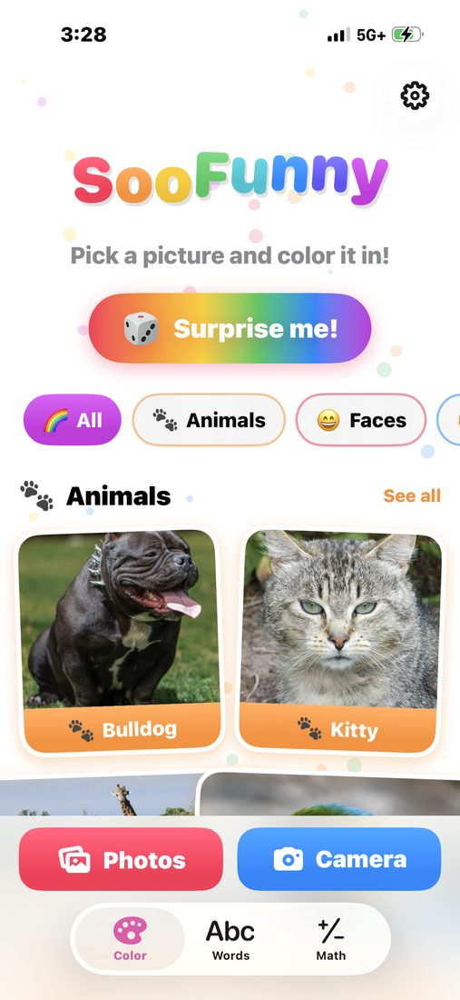
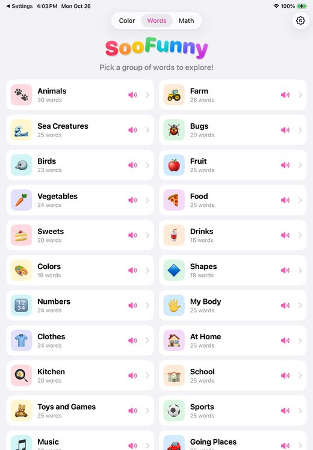
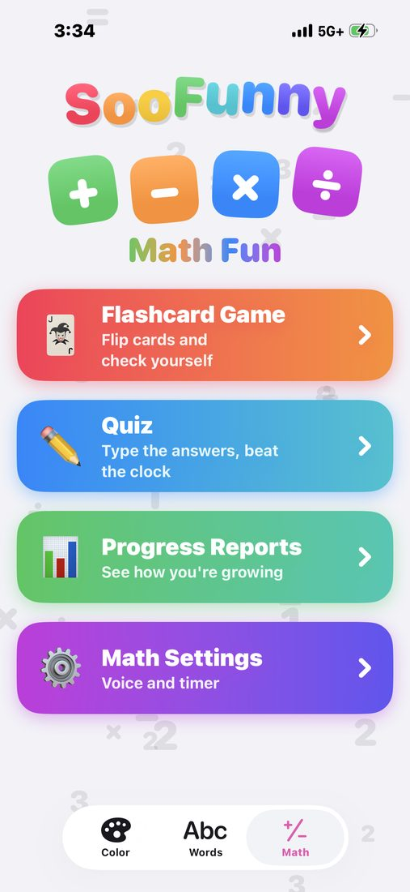
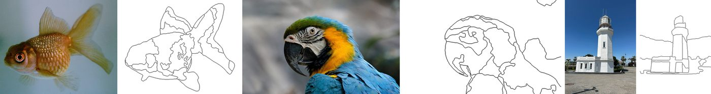

# SooFunny 🖍️

**Color, words and math for kids, on iPhone and iPad, completely offline.**

SooFunny turns any picture into a coloring page, lets kids explore 754 English words with a
talking buddy that answers their questions out loud, and makes math practice feel like a game.
Everything runs on the device: no Wi‑Fi, no accounts, no ads, and nothing a child says, draws or
photographs ever leaves the device.

<p align="center"></p>

<p align="center">
  
  &nbsp;
  
  &nbsp;
  
</p>

<p align="center"></p>

| | |
|---|---|
| **Version** | 0.1 (build 1) |
| **Platforms** | iPhone and iPad, iOS 17 or later, all orientations |
| **Developer** | [Chengjiang Long](https://www.chengjianglong.com/) |
| **Copyright** | © 2026 Soo Intelligence Inc. All rights reserved. |

---

## Contents

- [Features](#features)
- [How it works](#how-it-works)
- [SooFunny Premium](#soofunny-premium)
- [Privacy and child safety](#privacy-and-child-safety)
- [Building and running](#building-and-running)
- [Tests](#tests)
- [Project layout](#project-layout)
- [Changing content](#changing-content)
- [Releasing on the App Store](#releasing-on-the-app-store)
- [Performance](#performance)
- [Known limitations](#known-limitations)
- [Credits and licenses](#credits-and-licenses)

---

## Features

### 🎨 Color

- **A playful gallery**: a bouncing rainbow title, a **Surprise me!** button that opens a random
  picture, and sticker-style cards in five groups: **Animals**, **Faces**, **People**,
  **Outdoors** and **Drawings**. That's 15 free (CC0) photos plus 4 drawings made in code
  (House, Fish, Flower, Rocket).
- **Your own pictures**: **Photos** and **Camera** buttons at the bottom of the page.
- **Automatic coloring pages**: any picture becomes clean black outlines around kid-sized blocks.
  Choose **Big**, **Medium** or **Small** blocks.
- **Easy coloring**: tap a block, or drag a finger across several. Taps on a line snap to the
  nearest block.
- **Tools**: Undo, **Magic** (random colors everywhere), **Real** (each block in its photo
  color), **Peek** (see the original underneath), Clear, Eraser and a custom color picker. 18
  crayon colors.
- **Share or save** the finished picture with the system Share button.

### 📚 Words

- **32 word groups, 754 words**, written for SooFunny: Animals, Farm, Sea Creatures, Bugs,
  Birds, Fruit, Vegetables, Food, Sweets, Drinks, Colors, Shapes, Numbers, My Body, Clothes,
  At Home, Kitchen, School, Toys and Games, Sports, Music, Going Places, Weather, Seasons and
  Time, Nature, Space, Jobs, People, Feelings, Action Words, Opposites and Around Town.
- Every word has an emoji picture (or a colorful letter tile) and a **speaker** button.
  516 of the 754 words also show a **real photo**, with the emoji stuck on its corner like a
  sticker. Words that can't be photographed well (numbers, feelings, time words) keep just the
  emoji.
- A word page shows the word big, reads it aloud, lets kids tap each **letter** to hear it, and
  has Previous / Next.
- Tap a group to see its words; **Back** returns to the groups.

### ✨ Talking buddy

Every word has a sparkle **Talk about it** button that opens a spoken conversation, inspired by
the [Wonder Words Agent demo](https://www.youtube.com/shorts/ZAaAPILTohk):

1. The buddy explains the word in a sentence or two, then asks
   *"What would you like to know about lion?"*
2. It listens. The child asks out loud ("What does a lion eat?") or types a question.
3. It answers in a few short, kind sentences, read aloud with each word highlighted, then
   listens again.

The big button follows the turn: **Talk**, **Done** (while listening), **Cancel** (while
thinking) and **Stop speaking**. The answers come from Google's **Gemma 3 1B**, running on the
device.

### ➕ Math

Inspired by [Best Math App for Kids](https://www.youtube.com/watch?v=hVBYZOaC5iw):

- **Flashcard Game**: choose operations (+ − × ÷), the numbers 0–12 to focus on, 10/20/30
  questions, and whether to mark answers. Problems are stacked the school way; tap to reveal,
  then **Got it!** or **Not yet**.
- **Quiz**: "5 − 1 = ?" with a big number pad, a ✓ or ✗ (with the right answer), a timer and
  read-aloud questions.
- **Results**: stars, confetti for a perfect round, and **Practice missed ones**.
- **Progress Reports**: rounds, questions, a day streak, accuracy for each operation, and the
  trickiest facts to practice again.
- **Rules**: every question includes a chosen focus number, subtraction never goes below zero,
  and division always comes out even (never ÷ 0).

### 🗣️ Natural voice

Words, letters, math and the talking buddy are read by **Kokoro-82M**, a neural voice
("Heart", a warm American female voice) that runs on the device. Apple's built-in voices are
still available in Settings, minus novelty voices like "Boing". If the natural voice can't load,
the app uses an Apple voice automatically.

### ⚙️ Settings

- **Premium**: status, **Restore purchases** and **Manage subscription**.
- **Reading voice**: the voice, its speed (default about 1.05×) and a **Try the voice** button.
- **Research Lab** (for grown-ups): device info and on-device benchmarks of the coloring
  pipeline, Apple's Vision subject model and Apple's on-device language model (Apple
  Intelligence, iOS 26+), plus a prompt playground. Results stay on the device and export as
  JSON/CSV.
- **Photo credits**, **Reset defaults**, and **About** (version, developer, copyright).

### 📱 iPhone and iPad

On iPhone, the tabs sit at the bottom and the crayons scroll in one row. On iPad, the tabs sit at
the top, the crayons wrap into a grid, and in landscape the coloring tools move to a sidebar so
the picture stays big.

---

## How it works

### Coloring pages (`SooFunny/Engine/`)

**Drawings** (mostly black lines on white) keep their own lines: each enclosed area becomes a
block.

**Photos** go through a sketch pipeline:

1. **Flatten.** Repeated Kuwahara filtering in CIE Lab color removes texture and shading but
   keeps real edges sharp (`LabImage.swift`).
2. **Find the subject.** Apple's on-device Vision model separates people, pets and objects from
   the background (`SubjectMask.swift`). The subject gets more detail and the background stays
   simple, and no block mixes the two. Photos without a clear subject skip this step.
3. **Group colors.** k-means in Lab color (seeded, so results repeat), separately for subject and
   background, then a majority filter.
4. **Merge.** Neighboring blocks that look alike (small ΔE) join, so a sky stays one block. Tiny
   pieces and slivers merge into the neighbor they share the longest border with, until the
   count fits the chosen block size.
5. **Smooth.** Borders are rounded off, then redrawn at 1024 px with Gaussian-weighted contour
   smoothing, so lines look drawn rather than pixelated.
6. **Outline.** A distance transform draws an even, anti-aliased line about 3 px wide along every
   border.

### Talking buddy (`SooFunny/Assistant/`)

- **Thinking:** Gemma 3 1B (4-bit, Q4_K_M) is bundled with the app and runs with
  [llama.cpp](https://github.com/ggml-org/llama.cpp), built from source as an XCFramework.
- **Prompting:** answers are kept short and child-safe, with the last eight turns of the
  conversation as context. The app adds the "What would you like to know about …?" question
  itself, because a small model doesn't ask it reliably, and trims replies to a few sentences.
- **Listening:** Apple's speech recognition, required to run on the device. A turn ends after a
  1.4 s pause, after 8 s of silence, or after 20 s.
- **Speaking:** answers stream sentence by sentence into the voice, so speech starts before the
  whole answer is written.

### Natural voice (`SooFunny/Voice/`)

- **The voice:** [Kokoro-82M](https://huggingface.co/hexgrad/Kokoro-82M) (8-bit, 92 MB) with the
  "Heart" voice, run with [ONNX Runtime](https://github.com/microsoft/onnxruntime-swift-package-manager)
  on the CPU.
- **Pronunciation:** text becomes phonemes with a Swift port of the dictionary rules of
  [misaki](https://github.com/hexgrad/misaki), Kokoro's own phonemizer. It uses a
  183,561-word US dictionary, rules for small words ("a", "the", "to"…) and for -s, -ed and -ing
  endings, and spells out numbers. Unknown words are spelled letter by letter. The GPL
  espeak-ng phonemizer is deliberately not used.
- **No dead air:** the silence Kokoro adds around each clip is trimmed, and short natural pauses
  are added instead (0.22 s after a sentence, 0.12 s after a phrase). Long sentences are split
  at commas so speech starts after the first phrase.
- **Instant taps:** recent clips are remembered (up to 400), and likely-next speech is prepared
  in the background: group names, the words in an open group, the next and previous word, its
  letters, every question in a math round, and common cheers. Anything a child taps goes first.
- **Highlighting:** Kokoro doesn't report word timings, so the buddy's word highlighting is
  estimated from each word's length.

---

## SooFunny Premium

A yearly auto-renewing subscription: **$19.99 a year with a 7-day free trial**, with Family
Sharing. It uses StoreKit 2 (`SooFunny/Store/Premium.swift`); product ID
`com.chengjianglong.soofunny.premium.yearly`.

| Free | Premium |
|---|---|
| The 4 drawings, and the first 5 photos in each group (14 of 15) | Every gallery photo |
| 15 of your own pictures (Photos or Camera) | As many of your own pictures as you like |
| Animals, Colors and Numbers words | All 32 word groups |
| The talking buddy for every Animals word | The talking buddy for every word |
| + and − in Math with any number; × and ÷ with the numbers 1 to 5 | × and ÷ with every number |

The free amounts live in `FreeTier` (`SooFunny/Store/Premium.swift`). Own pictures are
counted on the device; a 🔒 appears when they run out.

- **Locks:** locked items show a 🔒. Tapping one asks a grown-up question (a two-digit
  multiplication) before showing Apple's subscription screen.
- **Offline:** StoreKit keeps the purchase on the device, so Premium keeps working without
  internet.
- **Testing purchases:** `SooFunny/Store/SooFunny.storekit` lets you test them in Xcode; the
  scheme uses it when you press **Run**.
- **Developer unlock:** Debug builds (installed from Xcode) turn Premium on, so you can try every
  feature on your own devices; Settings shows an orange note. It comes from the `DEV_UNLOCK`
  flag, set only for the Debug configuration in `project.yml`. App Store and TestFlight builds
  are Release builds, which don't have it, and `Premium.swift` refuses to compile if the flag
  is ever enabled outside Debug.

---

## Privacy and child safety

- **No data collected.** No analytics, ads, tracking, accounts or servers. The privacy manifest
  (`SooFunny/PrivacyInfo.xcprivacy`) declares no tracking and no collected data.
- **Photos** are turned into coloring pages on the device and are never uploaded.
- **Voice** is recognized on the device only and never recorded or saved. If a device can't
  recognize speech on the device, the buddy doesn't listen; children can type instead.
- **The buddy and the voice** run entirely on the device. Conversations are forgotten when you
  leave the screen.
- **Progress and settings** are stored only on the device.
- **Grown-up check:** purchases, the developer's website and the Research Lab sit behind a
  grown-up check. The photo credits are shown as text, not links.
- **Permissions:** the camera, microphone, speech recognition and saving to Photos are each
  requested only when first used.

Full policy: [PRIVACY.md](PRIVACY.md).

---

## Building and running

### Requirements

- A Mac with **Xcode 26 or later** (developed with Xcode 27.1), which includes the iOS SDK.
- **[XcodeGen](https://github.com/yonaskolb/XcodeGen)** and **CMake**:

```bash
brew install xcodegen cmake
```

- **Python 3**. `scripts/make_icon.py` also needs Pillow (`pip install pillow`).
- About **2 GB** of free disk space for the models and builds.

### 1. Get the large pieces (not stored in git)

```bash
./scripts/build_llama.sh
```

This builds llama.cpp (tag `b11577`) as an XCFramework for iOS devices and the Simulator, into
`Vendor/`. It takes a few minutes.

```bash
./scripts/fetch_model.sh
```

This downloads into `Models/`, checking each file's SHA-256:

- Gemma 3 1B `gemma-3-1b-it-Q4_K_M.gguf` (806 MB)
- Kokoro-82M `kokoro-82m-q8.onnx` (92 MB)

Both models are bundled into the app (about 918 MB in total), so it works offline from the
first launch.

### 2. Generate the Xcode project and open it

```bash
xcodegen generate
```

```bash
open SooFunny.xcodeproj
```

The project is generated from `project.yml`; run `xcodegen generate` again after adding or
removing files. Swift packages (ONNX Runtime 1.24.2) resolve automatically. If command-line
builds fail to resolve them, add `-scmProvider system` to `xcodebuild`.

### 3. Run

- **Simulator:** pick an iPhone or iPad simulator and press **Run**.
- **Your iPhone or iPad:**
  1. Connect it, turn on Developer Mode, and set your Team under *Signing & Capabilities*.
  2. Press **Run**.
  3. The first time, iOS needs **internet once** to verify the developer. If the app won't open,
     go to Settings → General → VPN & Device Management → your developer → **Verify App**.

  With a free Apple ID, device installs expire after 7 days; with the paid Developer Program they
  last a year.

From the command line:

```bash
xcodebuild build -project SooFunny.xcodeproj -scheme SooFunny -configuration Debug -destination 'id=<device UDID>' -derivedDataPath build-device -scmProvider system DEVELOPMENT_TEAM=<Team ID> -allowProvisioningUpdates
```

```bash
xcrun devicectl device install app --device <device UDID> build-device/Build/Products/Debug-iphoneos/SooFunny.app
```

---

## Tests

```bash
xcodebuild test -project SooFunny.xcodeproj -scheme SooFunny -destination 'platform=iOS Simulator,name=<simulator>' -scmProvider system
```

56 unit tests in `SooFunnyTests/`:

| File | What it checks |
|---|---|
| `ImageSegmenterTests` | Blocks and outlines for photos and drawings, gradients, subjects, block limits, rendering |
| `WordDictionaryTests` | Word list format and contents, Research Lab statistics and export, bundled gallery and word photos and their credits |
| `WordAssistantTests` | Prompts, sentence streaming and the buddy's turn flow (with fakes), plus real Gemma runs |
| `NaturalVoiceTests` | Pronunciations, Swift audio vs. the reference pipeline, speed, phrases, silence trimming, voice choices |
| `MathTests` | Question rules, flashcard and quiz sessions, scoring, progress and streaks |
| `PremiumTests` | Price and free trial, purchase, refund, lapse, the free tier and the Debug-only unlock |

Tests that need a bundled model skip when it's missing. The 3 Gemma tests take about 40 s, so
add `-skip-testing:SooFunnyTests/GemmaEngineTests` for a quick run. The StoreKit purchase tests
skip where the Simulator's local App Store isn't reachable (seen on the iOS 26.4 iPad
simulator); they pass on the iPhone simulator and from Xcode.

---

## Project layout

```
SooFunny/
  App/SooFunnyApp.swift            App entry point and the Color / Words / Math tabs
  Engine/                          Coloring pages
    PixelImage.swift                 RGBA bitmaps
    LabImage.swift                   Lab color and Kuwahara smoothing
    SubjectMask.swift                Apple Vision subject detection
    ImageSegmenter.swift             Picture → blocks and outlines, and the renderer
    ColoringSession.swift            Fill colors, undo, Magic / Real / Clear
  Views/                           Color tab, coloring screen, Settings, shared title
  Showcase/                        Gallery photos (CC0), credits.json and the gallery model
  Samples/SampleArt.swift          Built-in drawings, drawn in code
  Words/                           Word list (kids_words.txt), word browser, Speech
  Words/Photos/                    Word photos (CC0 / public domain) and word_photo_credits.json
  Assistant/                       Talking buddy: Gemma via llama.cpp, listening, prompts
  Voice/                           Natural voice: phonemizer, Kokoro via ONNX Runtime, player
    Resources/                       Pronunciation dictionary, phoneme table, Heart voice
  Math/                            Question maker, sessions, progress, and the Math screens
  Store/                           Premium subscription, paywall, grown-up check, .storekit
  Lab/                             Research Lab benchmarks and screen
  PrivacyInfo.xcprivacy            Privacy manifest
SooFunnyTests/                     Unit tests
scripts/
  build_llama.sh                   Builds llama.cpp for iOS
  fetch_model.sh                   Downloads and checks Gemma and Kokoro
  build_voice_lexicon.py           Rebuilds the pronunciation dictionary from misaki
  make_icon.py                     Makes the app icon from design/soo-icon.png
design/soo-icon.png                App icon artwork
docs/images/                       README screenshots
AppStore/LISTING.md                App Store listing, review notes, submission checklist
PRIVACY.md                         Privacy policy
project.yml                        XcodeGen project definition
```

---

## Changing content

- **Words:** edit `SooFunny/Words/kids_words.txt`. It has blank-line-separated sections, each
  starting with `Category: <name> | <emoji>`, then one word per line with an optional
  `| <emoji>`. Run the tests afterwards; they check the format and that every word can be
  spoken. The free groups are listed in `FreeTier` (`Store/Premium.swift`).
- **Gallery photos:** add a JPEG (about 1024 px) to `SooFunny/Showcase/` named
  `<group>-<name>.jpg`, and add an entry with title, author, license and source URL to
  `credits.json`. Use only photos you're allowed to bundle (the current set is all CC0). Check
  how it looks as a coloring page; busy photos make busy pages.
- **Word photos:** `python3 scripts/find_word_photos.py <folder>` searches Wikimedia Commons
  for CC0 and public-domain photos for every word, and `--sheets` makes contact sheets to
  review them. Record the chosen photo (or `null`) for each word in
  `scripts/word_photo_picks.json`, then run `python3 scripts/bundle_word_photos.py`. Check
  every photo by eye: search results include unsuitable pictures.
- **App icon:** replace `design/soo-icon.png`, then run `python3 scripts/make_icon.py`.
- **Pronunciation dictionary:** to rebuild it from newer misaki data, run
  `python3 scripts/build_voice_lexicon.py <folder with us_gold.json, us_silver.json, tokenizer.json>`.
- **Version:** change `MARKETING_VERSION` and `CURRENT_PROJECT_VERSION` in `project.yml`.

---

## Releasing on the App Store

Everything needed is in **[AppStore/LISTING.md](AppStore/LISTING.md)**: name, subtitle,
description, keywords, age rating, the subscription setup, App Privacy answers ("Data Not
Collected"), notes for App Review, screenshot sizes, and a step-by-step checklist.

In short:

1. **Developer Program:** join it.
2. **App Store Connect agreements:** accept the Paid Apps Agreement and add banking and tax
   details.
3. **Create the app and subscription** with the IDs above.
4. **Archive a Release build** with your Team ID and upload it.
5. **Test on TestFlight** with a Sandbox account.
6. **Submit** for review.

---

## Performance

Measured on an **iPhone 16** (optimized build) unless noted.

| What | Time |
|---|---|
| Voice: word prepared in advance, or said before | 0–6 ms |
| Voice: new word | about 0.65 s |
| Voice: first phrase of a buddy answer | about 1.1 s |
| Voice: model load at launch (in the background) | about 0.4 s |
| Voice: generation speed | about 2× faster than real time |
| Buddy: Gemma introduction (simulator on a Mac) | about 5 s |
| Coloring page from a photo (iPad simulator on a Mac) | 0.06–0.3 s |

Older devices, such as the iPad 10th generation, are slower, but prepared speech still plays
right away.

---

## Known limitations

- **App size:** about 918 MB, because both AI models are bundled for offline use.
- **The buddy:** a 1-billion-parameter model gives simple answers and can be wrong; the app says
  so. It knows only the word, not its picture.
- **Listening:** recognizing children's voices hasn't been tuned with real children yet. Devices
  that can't recognize English on the device can't listen; typing works instead.
- **The voice:** no offline voice is truly indistinguishable from a person yet. Words with
  several readings ("read") use their most common one, and the buddy's word highlighting is an
  estimate.
- **Coloring pages:** very busy photos (crowds, rocks, foliage) make busy pages; **Big blocks**
  helps. Subject detection needs a real device; the Simulator doesn't run it.
- **Research Lab:** Apple's on-device language model needs Apple Intelligence (iOS 26+,
  supported devices only).
- **Not yet on the App Store:** see [Releasing on the App Store](#releasing-on-the-app-store).

---

## Credits and licenses

SooFunny's own code, word list, artwork and text: © 2026 Soo Intelligence Inc. All rights
reserved. Bundled third-party parts keep their own licenses:

| Component | Use | License |
|---|---|---|
| [Gemma 3 1B](https://ai.google.dev/gemma) (GGUF by [unsloth](https://huggingface.co/unsloth/gemma-3-1b-it-GGUF)) | Talking buddy | [Gemma Terms of Use](https://ai.google.dev/gemma/terms) |
| [llama.cpp](https://github.com/ggml-org/llama.cpp) | Runs Gemma | MIT |
| [Kokoro-82M](https://huggingface.co/hexgrad/Kokoro-82M) and the "Heart" voice (ONNX by [onnx-community](https://huggingface.co/onnx-community/Kokoro-82M-v1.0-ONNX)) | Natural voice | Apache-2.0 |
| [misaki](https://github.com/hexgrad/misaki) dictionaries | Pronunciation | Apache-2.0 |
| [ONNX Runtime](https://github.com/microsoft/onnxruntime-swift-package-manager) | Runs Kokoro | MIT |
| Gallery photos from [Wikimedia Commons](https://commons.wikimedia.org/) | Color tab | CC0; photographers listed in Settings → Photo credits and `credits.json` |
| Word photos from [Wikimedia Commons](https://commons.wikimedia.org/) | Words tab | CC0 or public domain; listed in Settings → Photo credits and `word_photo_credits.json` |
| App icon "Soo" artwork | Icon | Provided by the developer |

Apple frameworks used: SwiftUI, StoreKit 2, Vision, Speech, AVFoundation, PhotosUI and, in the
Research Lab, FoundationModels.

Design references: the Words tab and Research Lab follow the design of the Android app
[frankdu/hack_android_base](https://github.com/frankdu/hack_android_base). No code, word list or
images were copied from it.

---

<p align="center">Made with ❤️ for curious kids by <a href="https://www.chengjianglong.com/">Chengjiang Long</a> · © 2026 Soo Intelligence Inc.</p>
