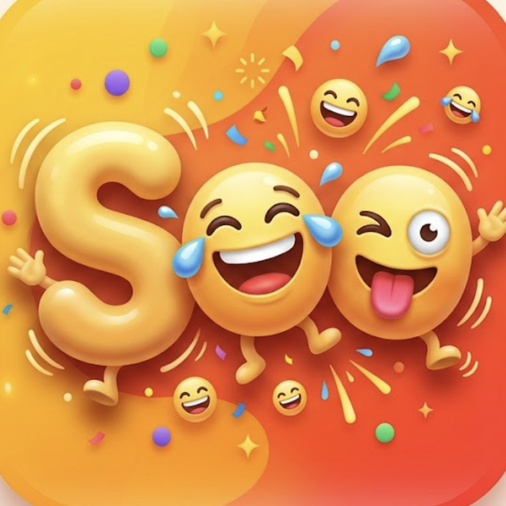

# SooFunny 🖍️

A coloring app for kids on **iPhone and iPad**. Pick any picture, and SooFunny splits it into
blocks. Kids tap (or swipe across) blocks to fill them with color.

**Works completely offline.** All image processing happens on the device. The app makes no
network requests and needs no Wi‑Fi, account or download.

<p align="center"></p>

## Features

- **Any picture**: choose a photo, snap one with the camera, or start from a built-in drawing
  (House, Fish, Flower, Rocket).
- **Automatic blocks**:
  - *Drawings / coloring pages*: every area enclosed by lines becomes a block.
  - *Photos*: colors are grouped, and each connected area becomes a block. Choose **Big**,
    **Medium** or **Small** blocks.
- **Kid-friendly coloring**: tap a block, or drag a finger to paint several blocks in one stroke.
  Taps on a line snap to the nearest block.
- **Fun tools**: Undo, **Magic** (random colors everywhere), **Real** (each block in its photo
  color), **Peek** (see the original underneath), Clear, Eraser, and a custom color picker.
- **Share / save** the finished picture through the system share sheet.
- **Words tab**: an English word browser for kids. Tap a category to see its words, tap a
  word to see it big, hear it, and tap its letters one by one; use Back to return to the
  categories. 32 categories and 754 words, written for SooFunny, each with an emoji picture
  where one fits. Words are read aloud with the iPhone/iPad's built-in voices (offline).
- **Talk about a word** (sparkle button on every word): a spoken conversation with an on-device
  buddy, like the [Wonder Words Agent demo](https://www.youtube.com/shorts/ZAaAPILTohk). It
  explains the word in a sentence or two and asks "What would you like to know about …?", then
  listens. Kids ask out loud (or type); the buddy answers in a few simple sentences, read aloud
  with each word highlighted as it's spoken, then listens again. The big button changes with the
  turn: **Talk**, **Done** (while listening), **Cancel** (while thinking), **Stop speaking**.
  Powered by Google's **Gemma 3 1B** (4-bit) running on the device with llama.cpp, plus Apple's
  on-device speech recognition and voices. No internet needed; nothing is recorded or saved.
- **Settings**: reading voice and speed, plus **Research Lab** (for grown-ups) with on-device
  benchmarks: the coloring-page pipeline, Apple's Vision subject model, and Apple's on-device
  language model (Apple Intelligence, iOS 26+) with a prompt playground. Results are kept on
  the device and export as JSON/CSV.
- Universal layout: a scrolling crayon row on iPhone and a wrapping crayon box on iPad. In iPad
  landscape, the tools move to a sidebar so the picture stays big. Every orientation is supported.

## How the blocks are made

Every picture becomes a clean coloring page: smooth black outlines on white, like a printed
coloring book. Everything runs on the device; nothing is downloaded.

**Drawings and coloring pages** (mostly black lines on white) keep their own lines. Each enclosed
area is a block, and the lines stay anti-aliased.

**Photos** go through a sketch pipeline in `SooFunny/Engine/`:

1. **Flatten.** Repeated Kuwahara filtering in CIE Lab color removes texture and shading but keeps
   real edges sharp (`LabImage.swift`).
2. **Find the subject.** Apple's built-in Vision model separates people, pets and objects from the
   background (`SubjectMask.swift`). The subject gets more detail and the background stays
   simple, and a block never mixes the two. Photos with no clear subject skip this step.
3. **Group colors.** k-means in Lab color (seeded, so results repeat), separately for subject and
   background, then a majority filter.
4. **Merge.** Neighboring blocks that look alike (small ΔE) join, so gradients such as a sky stay
   one block. Tiny pieces and slivers merge into the neighbor they share the longest border with,
   until the block count fits the chosen Big / Medium / Small size.
5. **Smooth.** Block borders are rounded off, then redrawn at 1024px with Gaussian-weighted
   contour smoothing, so lines look hand-drawn instead of pixelated.
6. **Outline.** A distance transform draws an even, anti-aliased ~3px line along every border.

## Words and Research Lab

The word list lives in `SooFunny/Words/kids_words.txt`: blank-line-separated sections, each
starting with `Category: <name>`, one word per line, with an optional `| <emoji>` picture.
Edit it and rebuild to change the vocabulary; `WordDictionaryTests` checks the format.

The Words tab and Research Lab follow the design of the Android app
[frankdu/hack_android_base](https://github.com/frankdu/hack_android_base) (category browser,
Back navigation, Settings → Research Lab). No code, word list or images were copied from it.
Its Gemma/LiteRT and image-generation tools are Android-specific and need multi-GB downloads,
so the iOS Research Lab uses models built into iOS instead and stays fully offline.

## Building

Requirements: Xcode 16+, iOS 17+, and [CMake](https://cmake.org) (`brew install cmake`).

The talking buddy needs two large pieces that aren't stored in git. Fetch them once:

```bash
./scripts/build_llama.sh
```

```bash
./scripts/fetch_model.sh
```

The first builds llama.cpp (tag `b11577`) as an XCFramework for iOS devices and the Simulator
into `Vendor/`. The second downloads Gemma 3 1B (`gemma-3-1b-it-Q4_K_M.gguf`, 806 MB, checked
against its SHA-256) into `Models/`. The model is bundled into the app, so the app is about
830 MB and works offline from first launch. Gemma is provided under the
[Gemma Terms of Use](https://ai.google.dev/gemma/terms).

```bash
open SooFunny.xcodeproj
```

Select an iPhone or iPad simulator (or your device: set your Team under *Signing &
Capabilities*), then press **Run**.

The Xcode project is generated from `project.yml` with [XcodeGen](https://github.com/yonaskolb/XcodeGen).
After adding or removing files, regenerate it:

```bash
xcodegen generate
```

Run the unit tests:

```bash
xcodebuild test -project SooFunny.xcodeproj -scheme SooFunny -destination 'platform=iOS Simulator,name=<your simulator>'
```

## Project layout

```
SooFunny/
  App/SooFunnyApp.swift          App entry point
  Engine/PixelImage.swift        RGBA bitmap helpers
  Engine/ImageSegmenter.swift    Picture → blocks, plus the renderer
  Engine/ColoringSession.swift   Fill colors, undo, Magic/Real/Clear
  Assistant/                     Talk-about-a-word buddy: Gemma via llama.cpp, speech in and out
  Samples/SampleArt.swift        Built-in drawings, drawn in code
  Views/                         SwiftUI screens
SooFunnyTests/                   Segmentation unit tests
design/soo-icon.png              Source artwork for the app icon
scripts/make_icon.py             Crops the artwork into the 1024px app icon
```
